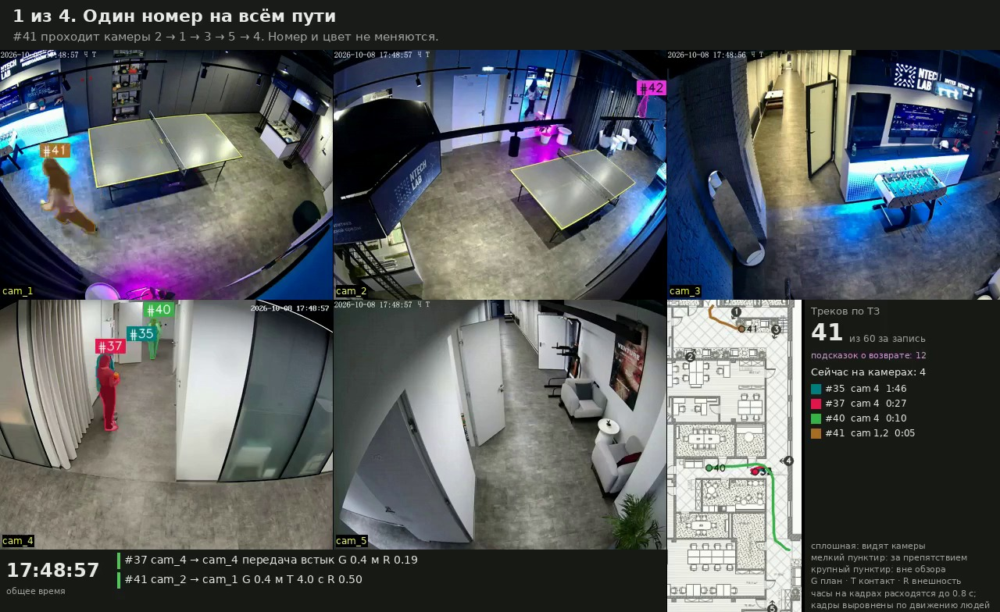

# Сквозной трекинг людей по камерам офиса

Команда **ТОКЕНЫ ЗАКОНЧИЛИСЬ**, хакатон NtechLab. Прототип находит людей на записях нескольких камер и ведёт человека одним номером, пока его видит хотя бы одна камера. Организаторы уточнили, что длительное отсутствие значит больше минуты: нет дольше минуты, и трек закрыт, а при возврате будет новый номер.

На предоставленной записи (20 минут, 5 камер) итоговая версия построила **60 сквозных треков**. Перечень с ID, началом, концом и камерами: [results/tracks.csv](results/tracks.csv). Запасной перечень без возвратов по внешности, 91 трек: [results/tracks_without_returns.csv](results/tracks_without_returns.csv). Алгоритм и его ограничения описаны в [docs/SOLUTION.md](docs/SOLUTION.md), результаты этой версии и сравнение с предыдущей — в [docs/TRIAL_60.md](docs/TRIAL_60.md).



**Для показа:** [короткий ролик](render/full/showcase.mp4), [офлайн-отчёт](render/full/report.html), [сценарий на пять минут](docs/DEMO_SCRIPT.md). Для пересборки медиа без нагрузки на ноутбук: [Colab-инструкция](docs/COLAB_DEMO.md) и [блокнот](colab/build_demo.ipynb).

| Критерий | Где проверить |
|---|---|
| Единый ID между камерами | «Треки»: видео с обведённым треком, снимки, камеры, таймлайн и связи; мозаика; [просмотр 309 связей](artifacts/test-results/transition_audit.csv) |
| Завершение и возвраты | Сегменты в досье; [трактовка минуты и ограничения](docs/LIMITATIONS.md); просмотр [закрытий](artifacts/test-results/closure_audit.csv) и [возвратов](artifacts/test-results/transition_audit.csv) |
| Перечень треков | `results/tracks.csv`: 60; это число треков, а не доказанное число людей. [Просмотр треков](artifacts/test-results/track_audit.csv) |
| Проверки и повторяемость | Раздел «Как проверяли»: 307 прежних и 2 новые склейки, изменившиеся снимки четырёх связей пересмотрены; закрытий верно 58 из 60; независимые точки 41 из 42; толпа 1551 из 1639 рамок на своём треке. Смотрел ИИ, человеком не подтверждено. [Результаты этой версии](docs/TRIAL_60.md) |
| Алгоритм и вклад команды | [Архитектура](docs/ARCHITECTURE.md), [описание решения](docs/SOLUTION.md) |

Ролики и отчёт согласованы с 60 треками; все 10 проверок демо и 202 теста прошли локально. Детекция на GPU заново не запускалась. Подробности и границы проверки — в [результатах тестирования](docs/TEST_RESULTS.md).

## Что нужно

- Windows, Linux или macOS и [uv](https://docs.astral.sh/uv/). Python 3.11 `uv` поставит сам, окружение занимает около 2 ГБ. Команды `make` доступны на Linux/macOS; на всех системах можно использовать `python run.py`.
- На Linux без графического окружения нужна системная библиотека `libgl1`: её требует OpenCV.
- Для демо и пересчёта треков GPU не нужен. Детекции на всей записи нужен GPU: в Colab это около полутора часов.

Для воспроизводимости сохранены пять исходных записей и план (`data/`), результат детекции (`artifacts/perception`), итоговые треки и снимки (`artifacts/tracks`), ролики и отчёт (`render/full`), используемые веса (`weights/`) и ТЗ (`docs/brief/`). Пробные прогоны и диагностические изображения из портфельной версии убраны.

## Запуск демо

```bash
git clone --depth 1 -b portfolio https://github.com/not-man/computer-vision.git
cd computer-vision
make setup
make demo
```

Эта команда запускает чистую портфельную версию с 60 треками после публикации ветки `portfolio`. Сданные и исследовательские версии сохранены в прежних ветках.

Интерфейс откроется на http://localhost:8501. Перед запуском `make demo` проверяет файлы и не даст начать показ, если что-то не сходится. Ничего не пересчитывается.

На Windows (PowerShell), после клонирования и перехода в папку проекта:

```powershell
python -m pip install uv
python run.py setup
python run.py demo
```

Проверка: `python run.py check`; тесты: `python run.py test`; полный пересчёт после детекции: `python run.py all`. Эти команды работают и на Linux/macOS. Запускатель включает UTF-8 для русских подписей и останавливается при ошибке любого этапа.

| Раздел | Что показывает |
|---|---|
| Витрина | Общее число треков и ролик до 90 с из фрагментов записи |
| Вся запись | Синхронное видео всех камер по минутам, силуэты и номера, события минуты |
| Треки | Таблица и таймлайн всех треков. У выбранного: камеры и время, снимки, связи, путь на плане, видео с обведённым жёлтой рамкой треком |
| Возвраты | Похожие пары после отсутствия дольше минуты. Это только подсказки: номера не склеиваются |
| Как проверяли | Итоги просмотра всех склеек и закрытий, независимые точки, таблица людей, устойчивость к порогам, опыты, которые не вошли в результат, известные ошибки |

Запасной вариант без сервера: откройте `render/full/report.html`. Отчёт открывает ролики из своей папки.

## Пересчёт

```bash
make all
```

Пересчитывает всё после детекции: треки, мозаику, снимки, проверку устойчивости, витрину и отчёт. Нужны `artifacts/perception` и `data/`, GPU не нужен, на ноутбуке это занимает 9–13 минут. На чистой копии репозитория перечень треков совпал побайтно: см. [docs/SOLUTION.md](docs/SOLUTION.md).

Детекцию и ReID запускайте на GPU. Удобнее всего в Colab: `colab/run_perception.ipynb`, архив кода для него собирает `scripts/make_colab_bundle.py`. На своей машине:

```bash
PYTHONPATH=src python scripts/run_perception.py data --out artifacts/perception --device 0 --model yolo11m-seg.pt
```

Веса YOLO и OSNet скачиваются при первом запуске.

## Команды

| Команда | Что делает |
|---|---|
| `make setup` | Ставит окружение без GPU |
| `make demo` | Проверяет файлы и запускает интерфейс |
| `make check` | Только проверка файлов перед показом |
| `make all` | Всё после детекции |
| `make test` | Тесты |

## Зависимости

Список в [pyproject.toml](pyproject.toml), точные версии в [uv.lock](uv.lock). Главные: `ultralytics==8.4.203` (YOLO11m-seg, BoT-SORT), `boxmot==26.0.0` (OSNet-AIN), `opencv-python==4.11.0.86`, `imageio-ffmpeg`, `scipy`, `numpy`, `pandas`, `pyarrow`, `pycocotools`, `pyyaml`, `pillow`, `matplotlib`, `lap`, `streamlit`, `plotly`.

В `pyproject.toml` указана лицензия AGPL-3.0-only.

## Документы

- [docs/SOLUTION.md](docs/SOLUTION.md): краткое описание решения.
- [docs/DESIGN.md](docs/DESIGN.md): подробный проект и измерения на записи.
- [docs/STATUS.md](docs/STATUS.md): текущее состояние работы.
