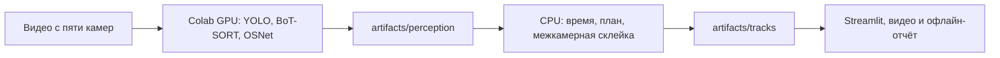

# Архитектура актуальной версии

Сборка `trial60-audited` даёт **60 сквозных треков** на двадцатиминутной записи с пяти камер. Готовые модели находят людей и ведут их внутри одной камеры. Код проекта сопоставляет эти фрагменты между камерами и назначает общий ID. Результаты и границы проверки приведены в [TRIAL_60.md](TRIAL_60.md).

## Контекст

Пять фиксированных камер, двадцать минут записи, общий план офиса. Время берётся из номера кадра и `configs/clocks.yaml`: метки времени видеоконтейнеров ненадёжны. Трек — траектория наблюдения, а не установленная личность.

## Компоненты и поток данных

1. **Внутри камеры.** YOLO11m-seg находит силуэты при входе 960 px и обработке 10 кадров в секунду. BoT-SORT присваивает наблюдениям локальные номера. OSNet-AIN кодирует внешность человека для сравнения между камерами. Рамки, маски и локальные номера сохраняются в Parquet, признаки внешности — в NPZ.
2. **Общий план и время.** Калибровка переводит точку стоп из кадра на план офиса с оценкой погрешности. Синхронизация по номерам кадров помещает все наблюдения на одну шкалу времени. `geometry.py` и `tracklets.py` готовят короткие фрагменты траекторий (треклеты), отбрасывают ложные наблюдения и разрезают некоторые перескоки локального трекера.
3. **Сквозной ID.** `trinity.py` сначала связывает фрагменты, совпадающие во времени и на плане, затем проверяет короткие переходы и разрывы. Для возврата в пределах минуты нужны уверенное сходство внешности и физически возможное перемещение. При паузе дольше минуты выдаётся новый ID. Склейка отклоняется, если создаёт конфликт между одновременными наблюдениями.
4. **Проверка хвоста.** После первой склейки алгоритм ищет конец трека, который резко перескочил на соседа. Для разреза нужны подтверждение позиции соседа с другой камеры и правдоподобный возврат исходного человека. Разрез сохраняется, если повторная склейка действительно восстанавливает этот возврат. В этой сборке так объединены прежние #25 и #33.
5. **Результат и показ.** `scripts/link_tracks.py` сохраняет ID, начало, конец и камеры, а также основания связей. Разметка контрольных примеров используется для оценки после назначения ID. Streamlit и офлайн-отчёт читают готовые треки и медиа.

## Технические решения

Тяжёлое восприятие отделено файловым форматом от быстрого пересчёта связей. Один источник данных и общие `summary.py`/`charts.py` обслуживают интерфейс и отчёт. При подозрительной ассоциации сохраняются основания и степень уверенности. Ошибки демонстрируются явно.

## Зависимости и запуск

Точные версии: `uv.lock`; зависимости и лицензия проекта: `pyproject.toml`. Запуск: `python run.py setup`, `python run.py demo`; Linux/macOS также поддерживают Makefile. Компоненты Ultralytics/BoxMOT и условия AGPL необходимо учитывать при распространении; LICENSE по решению пользователя пока не добавлен.

## Приватность

Обработка и демонстрация локальные. Репозиторий содержит записи и кадры с людьми, доступ к нему ограничен. Доступ экспертов проверяет команда. Приложение не устанавливает личность человека и не отправляет записи во внешние сервисы при обычном показе.
